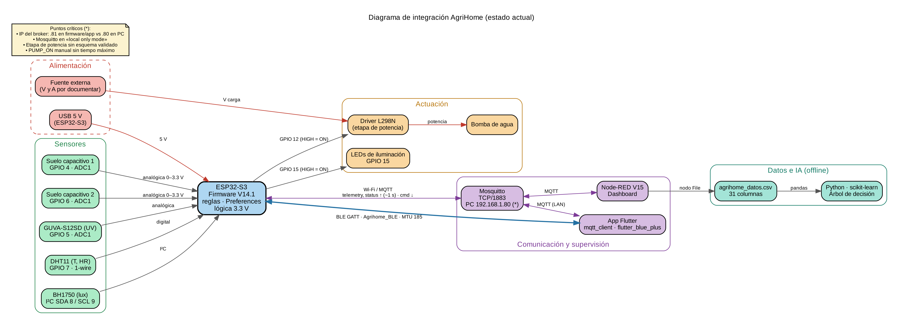

# AgriHome · Maceta inteligente

Sistema para monitorear y cuidar plantas de forma automatizada. Usa un **ESP32-S3** que mide la humedad del sustrato en dos puntos, la iluminación, la radiación UV, la temperatura y la humedad relativa. Con esas lecturas acciona una bomba de riego y LEDs mediante reglas automáticas con modo noche. Se supervisa desde un dashboard en **Node-RED** (vía MQTT) y desde una app **Flutter** (vía MQTT en la red local o por Bluetooth LE). El histórico se guarda en CSV para analizarlo con un modelo de IA fuera de línea.

Proyecto del Instituto Tecnológico Superior de la Región de los Llanos (TecNM), para Taller de Investigación II e InnovaTecNM 2026.



## Equipo

| Integrante | Función |
|---|---|
| Rubén Álvarez | Coordinación general · firmware y comunicaciones |
| Daniel Cisneros | Diseño, interfaces (app y dashboard) y presentación |
| David Castruita | Hardware, electrónica y ensamble |
| Samantha Camacho | Pruebas, datos e IA, documentación |

## Estructura del repositorio

```
Agrigome/
├── Agrihome-Platformio/     Firmware ESP32-S3 (PlatformIO + Arduino)
│   ├── platformio.ini       Placa esp32-s3-devkitc-1 y librerías
│   └── src/main.cpp         Lectura, reglas, MQTT, BLE, modo noche, persistencia
├── Agrihome-Flutter/        App móvil (MQTT + BLE)
│   └── lib/main.dart
├── Agrihome-NodeRed.json    Flujo Node-RED V15: dashboard, comandos, configuración y CSV
├── ia/                      Modelo de IA de necesidad de riego (Python, fuera de línea)
├── docs/                    Protocolo MQTT/BLE, hardware y diagrama de integración
└── CHANGELOG.md             Historial de versiones
```

## Puesta en marcha

Las credenciales **no** están en el repositorio, porque es público. El código trae marcadores que se reemplazan solo en la copia local:

| Archivo | Marcador | Valor real |
|---|---|---|
| `Agrihome-Platformio/src/main.cpp` | `"Nombre del punto WIFI"`, `"Contraseña del punto WIFI"` | SSID y contraseña de la red 2.4 GHz |
| `Agrihome-Platformio/src/main.cpp` | `MQTT_HOST "IP en cuestion"` | IP de la PC con Mosquitto |
| `Agrihome-Flutter/lib/main.dart` | `mqttHost = 'IP en cuestion'` | IP de la PC con Mosquitto |
| `Agrihome-NodeRed.json` | `"broker": "IP_DEL_BROKER"` | IP de la PC con Mosquitto (o `localhost`) |

> Antes de hacer `commit`, verifica con `git diff` que no subes la contraseña ni la IP real.

### 1. Broker MQTT (Mosquitto)

Mosquitto 2.x arranca en *local only mode* si no se configura. Para aceptar conexiones de la red local, agrega a `mosquitto.conf`:

```
listener 1883 0.0.0.0
allow_anonymous false
password_file C:\mosquitto\passwd
```

Crea el usuario con `mosquitto_passwd -c C:\mosquitto\passwd agrihome`, permite **TCP 1883** en el firewall de Windows y reserva la IP de la PC en el router para que no cambie.

> El firmware y la app actuales se conectan sin usuario. Mientras no se agreguen credenciales MQTT a ambos, usa `allow_anonymous true`, y solo en una red de confianza.

Comprobación: `mosquitto_sub -h <IP> -t "agrihome/#" -v`

### 2. Firmware (PlatformIO)

1. Abre `Agrihome-Platformio/` en VS Code con la extensión PlatformIO.
2. Reemplaza los marcadores de Wi-Fi y MQTT en `src/main.cpp`.
3. **Upload** y luego **Monitor** (115200 baudios). Debe aparecer `Agrihome ESP32-S3 Firmware V14.1`.

### 3. Node-RED

1. Instala el paquete `node-red-dashboard`: Menú → Manage palette → Install.
2. Menú → Import, y selecciona `Agrihome-NodeRed.json`.
3. Abre el nodo de configuración **Mosquitto Agrihome**, cambia `IP_DEL_BROKER` por la IP real y haz **Deploy**.
4. El dashboard queda en `http://localhost:1880/ui`.

El CSV `agrihome_datos.csv` se crea en el directorio desde el que se ejecuta Node-RED (para usar una ruta absoluta, edita el nodo *agrihome_datos.csv*). El selector **Intervalo de registro** permite grabar cada 1 s (tiempo real) o cada 30 s (registro de larga duración).

### 4. App Flutter

```
cd Agrihome-Flutter
flutter pub get
flutter run                 # depuración con el teléfono conectado
flutter build apk --release # APK en build/app/outputs/flutter-apk/
```

### 5. Modelo de IA

Ver [`ia/README.md`](ia/README.md).

## Protocolo

Tópicos `agrihome/telemetry`, `agrihome/status` y `agrihome/cmd`; comandos `PUMP_ON`, `PUMP_OFF`, `LEDS_ON`, `LEDS_OFF`, `AUTO_ON`, `AUTO_OFF`, `STATUS` y `SET_CONFIG` (JSON). El detalle de campos y paquetes BLE está en [`docs/PROTOCOLO.md`](docs/PROTOCOLO.md), y el mapa de pines en [`docs/HARDWARE.md`](docs/HARDWARE.md).

## Limitaciones conocidas (V14.1)

- El comando `PUMP_ON` manual no tiene tiempo máximo: no dejes la bomba sin supervisión (cambio CH-05 planeado para V14.2).
- El cooldown entre riegos está limitado a 120 s en el firmware, aunque la app lo muestre en horas (cambio CH-07).
- Los umbrales de suelo están en valores RAW sin calibrar por sustrato.
- El reloj del modo noche avanza con `millis()`: hay que sincronizar la hora tras cada reinicio.
- El modelo de IA reproduce la regla de umbral; no controla la bomba.
